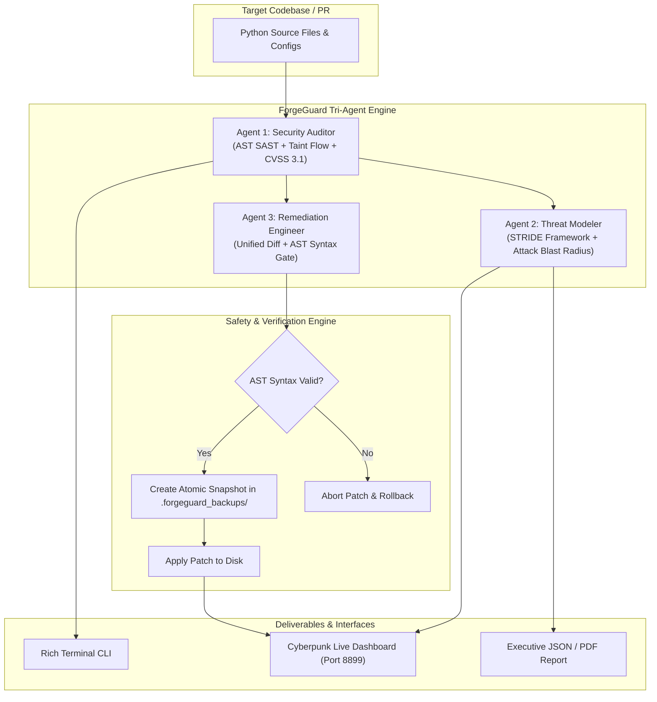

# 🛡️ ForgeGuard
### Autonomous AI Code Vulnerability Scanner, STRIDE Threat Modeler & Patch Engine

[](https://www.python.org/downloads/)
[](https://opensource.org/licenses/MIT)
[](https://youtu.be/QicTSnnBr9k)
[](https://owasp.org/www-project-top-ten/)
[](https://en.wikipedia.org/wiki/STRIDE_(security))
[](https://forgehacks.devpost.com)

> 🎥 **Watch the 3.5-Minute Full Demo Walkthrough:** [https://youtu.be/QicTSnnBr9k](https://youtu.be/QicTSnnBr9k)

**ForgeGuard** is an enterprise-grade cybersecurity platform that unites **static abstract syntax tree (AST) vulnerability auditing**, **automated STRIDE threat modeling**, and **autonomous AST-verified code remediation** into a unified tri-agent AI system.

ForgeGuard operates with **zero heavy external dependencies** (pure Python standard library core), achieves **sub-10ms scan speeds**, and guarantees **zero broken builds** via strict pre-commit AST verification and 1-click snapshot rollback safety.

---

## 🌟 Key Capabilities

1. **Sub-10ms SAST AST Scanner**:
   - Analyzes Python source trees via recursive AST visitors and dynamic taint-flow tracking.
   - Detects OWASP Top 10 / CWE vulnerabilities (SQL Injection, Command Injection, Insecure Deserialization, Hardcoded Secrets, Path Traversal, Weak Crypto, Predictable PRNGs, Eval Injection).
2. **Automated STRIDE Threat Engine**:
   - Maps detected entry points to all 6 STRIDE categories: **Spoofing, Tampering, Repudiation, Information Disclosure, Denial of Service, and Elevation of Privilege**.
   - Computes asset blast radius, attack surfaces, and architectural mitigations in real-time.
3. **Self-Healing Autonomous Patcher**:
   - Synthesizes standardized unified diffs with secure modern APIs (parameterized queries, `subprocess.run(shell=False)`, `json.loads`, `os.environ.get`, `secrets`).
   - Validates patched code against Python AST before writing to disk.
   - Creates automatic atomic backups in `.forgeguard_backups/` with instant rollback capabilities.
4. **Featherless AI Inference Bridge**:
   - Connects to open-source foundation models (Meta-Llama-3.1-8B-Instruct) on Featherless.ai for contextual threat intelligence with a deterministic offline heuristic synthesizer fallback.
5. **Interactive Cyberpunk Web Dashboard**:
   - Real-time Tailwind CSS dark-mode UI with CVSS 3.1 gauges, STRIDE matrix inspector, side-by-side diff studio, and 1-click auto-patch triggers.

---

## 🏗️ Tri-Agent Collaborative Architecture



---

## 🚀 Quickstart Guide

### 1. Installation
Clone the repository and run ForgeGuard directly using Python 3.11+:
```bash
git clone https://github.com/karan5028ji/forgeguard.git
cd forgeguard
```
*Zero pip installs required for core engine.*

### 2. Run High-Speed SAST Scan
Scan any file or project directory:
```bash
python -m forgeguard.cli scan examples/vulnerable_app/app.py
```

### 3. Generate Full Executive Audit with STRIDE Threat Model
```bash
python -m forgeguard.cli audit examples/vulnerable_app/ --json audit_report.json
```

### 4. Autonomous Dry-Run or Real Code Patching
```bash
# Preview patches without modifying code
python -m forgeguard.cli patch examples/vulnerable_app/ --dry-run

# Safely apply all verified patches to disk
python -m forgeguard.cli patch examples/vulnerable_app/
```

### 5. Launch Interactive Live Dashboard
```bash
python -m forgeguard.cli serve examples/vulnerable_app/ --port 8899
```
Open **`http://localhost:8899`** in your browser to inspect findings, explore STRIDE matrices, and test 1-click remediation.

---

## 📋 Standardized Rules Catalog

| Rule ID | Title | OWASP Category | CWE ID | Default CVSS |
| :--- | :--- | :--- | :--- | :--- |
| **FG-SEC-001** | SQL Injection via Formatted Query | A03:2021-Injection | CWE-89 | **9.8 (CRITICAL)** |
| **FG-SEC-002** | OS Command Injection (`shell=True`) | A03:2021-Injection | CWE-78 | **9.8 (CRITICAL)** |
| **FG-SEC-003** | Insecure Object Deserialization (`pickle`) | A08:2021-Integrity Failures | CWE-502 | **9.8 (CRITICAL)** |
| **FG-SEC-004** | Hardcoded Credentials / API Secrets | A07:2021-Auth Failures | CWE-798 | **7.5 (HIGH)** |
| **FG-SEC-005** | Arbitrary Path Traversal | A01:2021-Broken Access | CWE-22 | **8.6 (HIGH)** |
| **FG-SEC-006** | Weak Cryptographic Hash (MD5 / SHA1) | A02:2021-Crypto Failures | CWE-327 | **5.9 (MEDIUM)** |
| **FG-SEC-007** | Insecure PRNG for Security Tokens | A02:2021-Crypto Failures | CWE-338 | **5.3 (MEDIUM)** |
| **FG-SEC-008** | Dynamic Code Evaluation (`eval`/`exec`) | A03:2021-Injection | CWE-95 | **9.8 (CRITICAL)** |
| **FG-SEC-009** | Permissive CORS Wildcard Policy | A01:2021-Broken Access | CWE-942 | **3.7 (LOW)** |

---

## 🧪 Comprehensive Test Suite

ForgeGuard includes a full unit and integration test suite:
```bash
python -m unittest discover -s tests -p "test_*.py" -v
```
**Results:** `6/6 tests passing (0.044s)` covering AST visitors, STRIDE modelers, patchers, rollback snapshots, and full engine reports.

---

## 🏆 Hackathon Metadata

- **Event:** ForgeHacks 2026 (Devpost)
- **Track:** AI + Cybersecurity
- **Project Name:** ForgeGuard (Autonomous AI Code Vulnerability Scanner, STRIDE Threat Modeler & Patch Engine)
- **Slide Deck:** `PRESENTATION_SLIDES.pdf` (8 slides, high-res PDF in repo root)
- **License:** MIT
